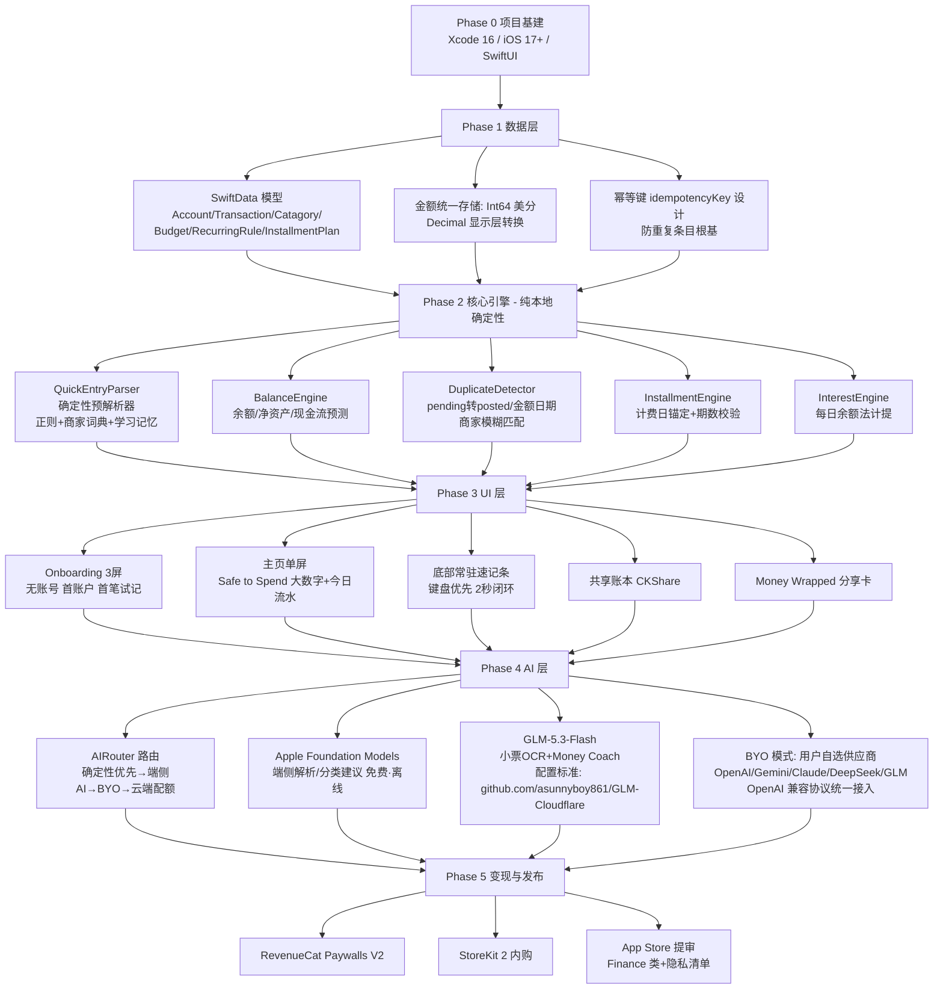
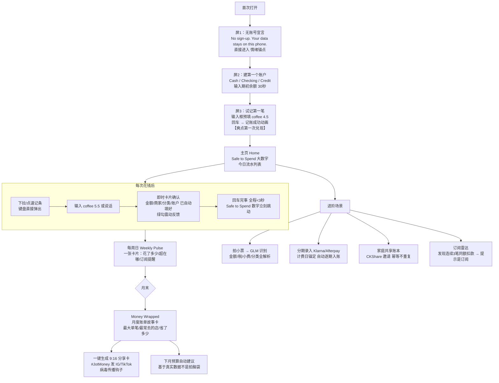
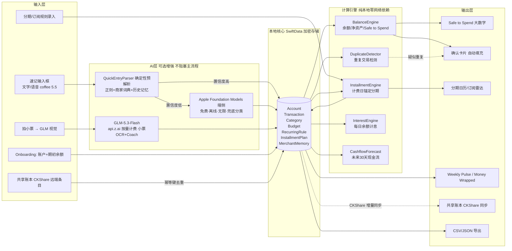

# TR-20261013-买断记账（JotMoney）- 操作指南

> **文档目的**：任何 LLM / 开发者阅读本文档后，可以完整复刻出一款极具竞争优势的 iOS 记账 App。
> **对标产品**：Tarsi（$20K/月，多国付费榜#1，Tap & Swipe 2026-05 访谈验证）、YNAB、Copilot Money、Monarch
> **目标市场**：🇺🇸 美国（订阅疲劳 + Plaid 断连 + $95-199/年 订阅制记账的空档期）
> **文档日期**：2026-10-13

---

## ⭐ App 命名与副标题（写在最上面）

| 项目 | 内容 |
|---|---|
| **App 名称** | **JotMoney** |
| **副标题（Subtitle，30字符内）** | `Type it. Done. No subscription` |
| **完整商店名（Name+Subtitle 组合）** | JotMoney — Type it. Done. No subscription |
| **类别** | Finance（财务） |
| **年龄分级** | 4+（纯记账工具，无敏感内容） |

### 命名分析（为什么是 JotMoney）

| 维度 | 分析 |
|---|---|
| **品牌记忆度（最关键）** | "Jot"（飞快记一笔）是英语高频动词，单音节、幼儿园级词汇，含义就是本 App 的核心动作——打开、jot、关掉，2 秒完事。名字即使用动作，用户第一次听到就懂怎么用。两个实词组成 "JotMoney"，读一遍就忘不掉。 |
| **病毒传播** | 口号 "Just Jot it."（仿 "Just Do It" 的句式节奏，但不构成侵权）天然是广告语；用户晒图配文 "Just jotted it #JotMoney" 自带品牌曝光——**品牌名即话题标签**。月末 Money Wrapped 分享卡右下角带 JotMoney 水印，每次分享都是免费获客。 |
| **ASO 搜索优化** | 名称直接包含品类大词 "Money"（App Store 搜索权重最高的字段之一）；副标题覆盖 "Type it"（自然语言记账心智）、"No subscription"（订阅疲劳人群的强意图搜索词，2026 年该词的搜索量随订阅疲劳激增）；关键词字段补齐：expense tracker, budget, spending, ledger, finance, offline, one-time, privacy。 |
| **功能描述性** | Jot = 快速记下 + Money = 钱，目标用户 0 歧义；比 Tarsi（拉丁语词根，无语义）更符合美国大众直觉。 |
| **情感共鸣** | "No subscription" 直接替用户说出对 YNAB $109/年、Copilot $95/年、Monarch $199/年 的愤怒；名字轻快（jot 本身有"轻松随手"的情绪），不严肃不吓人。 |
| **国际化适配** | 纯 ASCII 短词，无变音符号，所有语言键盘可输入，logo 设计空间大（J 字形笔尖 + 硬币）。 |
| **合规与占位验证** | 2026-10-13 经 iTunes Search API（美区）实查：**JotMoney 未见占用**（仅模糊命中无关 App）；⚠️ 提交前需在 App Store Connect 再次校验名称可用性。**严禁**使用 Tarsi / YNAB / Copilot / Monarch / Spendle / TapLedger（实查已被占用）等已存在名称。 |
| **备选名（若 Connect 校验失败）** | 1）`PennyJot`（实查未见占用，Penny 更萌）2）`Blipbook`（实查未见占用，Blip=一瞬）3）`Quickscribble`（实查未见占用） |

---

## 一、调研总结：痛点、竞品与机会

### 1.1 赛道验证

- Tarsi：首月 **$20,000**（iOS 占 75%），日均 $350 稳定销售，美国/法国/挪威/菲律宾/加拿大多国**付费榜 #1**，30,000+ 用户，App Store "Hidden Gems" 推荐（Tap & Swipe 2026-05-23）。
- 创始人 Bryl Lim 的核心洞察原话："Everyone builds free apps with subscriptions now. That means the paid charts are empty."（所有人都在做免费+订阅，付费榜是空的）——证明**订阅疲劳时代，"买断/明码标价"本身就是获客武器**。
- 美国竞品正在集体涨价：YNAB $109/年、Monarch 推出 $199/年 Plus 档（2026-04）、Copilot $95/年——价格天花板不断抬高，"$0 起步 + $19.99/年"是降维打击位。

### 1.2 竞品盘点（2026-10 实查）

| 竞品 | 定价 | 核心功能 | 弱点 |
|---|---|---|---|
| Tarsi | **$4.99 买断** + Cloud €22.99/年 | 自然语言记账、离线端侧解析、多账户净资产、分期、利息、共享账本、OCR 小票 | 更新日志自曝：分期计费日错误、共享账单重复条目、循环计划消失、利息记录错误需手动修正、大小写重复人名；无银行连接（用户抱怨数据非实时）；无桌面端 |
| YNAB | $109/年 或 $14.99/月 | 零基预算金标准 | 学习曲线陡（"有大学生课程那么难"）；涨价静默生效；自动续费全额扣款是 3500+ 条 1-3 星评论的最大差评来源 |
| Copilot Money | $95/年 或 $12.99/月 | 美貌 UI + AI 分类 | AI 分类需手动纠正；投资模块弱；无免费档 |
| Monarch | $99.99/年（Plus $199/年） | 全景财务 + 银行同步 | Plaid 断连（Chase/Capital One 每 7-14 天重认证）；Mint 迁移丢数据 |
| Rocket Money | 免费档 + Premium $7-14/月 | 订阅取消+账单谈判 | 账单谈判抽成首年节省额的 30-60%；推销密度高 |
| Buckets | $64 买断 | 信封预算 | 桌面优先、移动体验差、价格偏高 |
| EveryDollar | 免费手动 + $79.99/年 | Ramsey 预算法 | 手动逐笔录入摩擦大（"Manual entry on a phone for every transaction is friction the free tier does not solve"） |
| Actual Budget | 免费开源 | 本地优先 | 需自托管/手动导入，官方 iOS 版 2026 年底才上线，大众用户门槛高 |

### 1.3 用户痛点（按强度排序）

1. **手工记账太麻烦**：美国记账类目差评第一大来源（EveryDollar 免费档差评聚类）。用户要的是"打两个字就完事"，不是表单填空。
2. **订阅疲劳 + 续费陷阱**："I'm using a budgeting app… and it costs more than Netflix."（一个帮我省钱的 App 比 Netflix 还贵）；YNAB 年度自动续费全额扣款+退款被拒是 3500+ 条低分评论的最大来源（Unstar 2026 五强差评分析）。
3. **银行同步不可靠**："My credit union would disconnect every few weeks… Duplicate transactions appeared regularly, especially around pending-to-posted transitions."（连接频繁断、pending 转 posted 时重复交易成堆）——Plaid 路线的原罪。
4. **数据隐私焦虑**：银行聚合（Plaid）要把网银凭证交给第三方；隐私敏感用户正在涌向 local-first 工具（Actual 的 "your data lives on your own device" 是其最高频好评点；Tarsi 的"无账号、数据不出设备"是其零差评面的第一好评点）。
5. **Tarsi 自曝的正确性 bug（财务 App 零容忍领域）**：v2.4.5-2.4.7 更新日志连续修复——BNPL 分期计费日错误、共享账单编辑产生重复条目、他人消费虚增统计、循环计划因相似旧条目消失、储蓄目标利息记录错误需手动修正、不同大小写产生重复人名。**记账 App 的核心资产是"数字可信"，谁先把正确性做扎实谁赢。**
6. **周期性账目（分期/订阅/循环）管理弱**：BNPL（Klarna/Afterpay/Zip）在美国年轻用户中渗透率极高，但几乎所有手动记账 App 的分期功能都做得很脆。

### 1.4 我们的碾压策略（一句话）

> **免费层给到竞品付费才有的完整记账能力（离线 + 无账号 + 隐私）+ "2 秒记账"极致输入体验（Apple 端侧 AI 免费解析 + GLM-5.3-Flash 小票识别与深度推理）+ 财务正确性引擎（重复检测/分期锚定/利息引擎——把 Tarsi 的差评做成我们的功能）+ 明码标价 $19.99/年 主推 + BYO 买断制**

---

## 二、产品定义

### 2.1 一句话

**JotMoney 是"2 秒记一笔"的私人账本**：打开输入 "coffee 5.5" 回车即完成记账（AI 自动识别金额/商家/分类/账户），全程离线、无账号、数据不出设备——并且每一笔账、每一期分期、每一分利息都算得对。

### 2.2 核心功能矩阵（对比竞品）

| 功能 | Tarsi | YNAB/Copilot/Monarch | **JotMoney** |
|---|---|---|---|
| 自然语言记账（"coffee 5.5"） | ✅买断 | ❌（表单） | ✅**免费层 10 次/天，Pro 无限** |
| 语音记账 | ✅ | ❌ | ✅（端侧听写→同一解析管线） |
| 小票 OCR 识别 | ✅（端侧，精度一般） | Copilot 部分 | ✅**GLM-5.3-Flash 视觉（Pro）精度碾压** |
| 离线可用 / 无账号 | ✅ | ❌（强制云+银行连接） | ✅**本地优先，iCloud 同步可选** |
| 多账户 + 净资产 | ✅ | ✅ | ✅免费层即含 2 账户，Pro 无限 |
| **Safe to Spend 今日可花数字** | ⚠️弱 | Copilot 有 | ✅**主页唯一大数字（爽点核心）** |
| 重复交易自动检测 | ❌（自曝 bug） | Plaid 类经常出重复 | ✅**端侧模糊匹配引擎（独有卖点）** |
| 分期/BNPL 计费日正确性 | ❌（bug 史） | ⚠️ | ✅**计费日锚定引擎（独有卖点）** |
| 利息精确计提（每日余额法） | ❌（bug 史） | ⚠️ | ✅**InterestEngine（独有卖点）** |
| 家庭/共享账本 | ✅（有重复条目 bug） | Monarch 有 | ✅CKShare 幂等条目（Pro） |
| 现金流预测 + 订阅雷达 | ✅部分 | ✅付费 | ✅Pro |
| Money Wrapped 月度分享卡 | ✅（Wrapped） | ❌ | ✅**社交传播钩子 #JotMoney** |
| BYO 多模型 AI | ❌ | ❌ | ✅**GLM/OpenAI/Gemini/Claude/DeepSeek/自定义** |
| 最低长期成本 | $4.99 + €22.99/年 | $95-199/年 | **$0 免费 / $19.99/年 / 终身 BYO $59.99** |

---

## 三、实现流程图（开发实现视角）



**开发周期**：核心（Phase 0-3）3-4 周；AI 层 +1 周；共享账本 +1 周。总 5-6 周 MVP 完整体。

---

## 四、用户使用流程图（极端重要：爽文级体验）

设计总纲：**"想到 → 打两个字 → 完事"**。记账的最大敌人是"懒得记"，所以整个产品围绕把记账压到 2 秒：无账号注册、无强制表单、无分类选择弹窗。全流程 3 屏完成 onboarding，日常记账一个输入框搞定。



### 爽感设计要点（把"看爽文"的体验做进产品）

1. **一个数字统治一切**：主页只有一个大数字（Safe to Spend：今天还能花多少）+ 下方今日流水。用户打开 App 的 95% 目的（"我还能花钱吗"）0.5 秒得到答案。零学习成本。
2. **2 秒闭环的肌肉记忆**：输入 → 自动填充 → 回车。分类不用选（AI 猜 + 记住你的纠正，第二次同商家自动归档）。**记账从"填表"变成"发短信"**。
3. **即时正反馈**：每笔记账成功 = 绿勾 + 触觉震动 + 大数字实时跳动（"你刚记了一笔，今天的余量变成 $42"）。让"记了一笔"本身有奖励感。
4. **AI 猜中即爽**：用户输入 "sbux" 也能识别成 Starbucks（词典 + 学习历史）；猜错时轻点即可改，改完永远记住。**每一次纠正都让 App 变得更懂你**——这是养成系爽感。
5. **月末仪式感**：Money Wrapped 把枯燥账单变成可晒的故事卡（"你这个月最常去的地方：Costco ×12 次"）——记账本来无趣，分享时刻变高光。
6. **零弹窗零广告零注册墙**：免费层也不塞任何拦截——口碑即增长。

---

## 五、软件数据流图（极端重要：真实可靠，不虚假）

### 5.1 核心数据流



### 5.2 数据正确性设计（不易出错的关键——直接针对 Tarsi 的 bug 史）

| 风险点 | 防错设计 |
|---|---|
| **重复条目**（Tarsi 自曝 bug） | 每条 Transaction 生成 `idempotencyKey`（UUIDv7，输入时间+内容哈希）；`DuplicateDetector` 在保存前扫描：金额相等（±1美分容差）∧ 日期窗口 ±3 天 ∧ 商家相似度（Jaro-Winkler ≥0.85）→ 弹出"疑似重复，确认一下？"而不静默丢弃（既防重复也不误吞真实两笔消费） |
| **pending→posted 重复**（Plaid 类通病，手动录入场景为"补记"） | 同商家同金额窗口内出现第二笔时默认勾选"这是之前那笔的确认"选项，一键合并并保留原始记录时间戳；合并操作写审计日志可撤销 |
| **共享账本重复/虚增**（Tarsi 自曝 bug） | CKShare 同步以 `idempotencyKey` 为主键做 upsert（不是 append）；共享条目按创建者归属统计，统计口径 = 参与者各自视图聚合，杜绝"他人消费算进我的支出" |
| **分期计费日错误**（Tarsi 自曝 bug） | `InstallmentEngine` 采用**计费日锚定**：以首笔日期为锚点，逐期用 `Calendar.date(byAdding:to:)` 生成，月末自动钳位（1/31 → 2/28）；期数、每期金额、总额三方校验（期数×每期 = 总额 ±1 美分尾差摊到首期），校验不过禁止保存 |
| **利息算错**（Tarsi 自曝 bug） | `InterestEngine` 用**每日余额法**：按自然日逐日累计余额快照计息，APR 与计息周期显式配置；计提记录生成独立 InterestEntry 可人工修正且修正留痕（不静默覆盖） |
| **大小写重复人名/商家**（Tarsi 自曝 bug） | MerchantMemory 归一化：存储统一 lowercase + trim，展示层保留用户偏好大小写；别名合并（"sbux"→"Starbucks"） |
| **循环计划消失**（Tarsi 自曝 bug） | RecurringRule 与生成的 Transaction 分离存储：规则是唯一事实源，流水由规则按日历展开生成并打 `ruleID` 标记；删除流水不影响规则，规则修改只影响未来期 |
| **金额精度** | 内部统一 **Int64 美分** 存储（绝不用 Double 算钱），显示层 Decimal 格式化；多币种按账户币种存储，汇率快照记入交易 |
| **时区/日期边界** | 全部用 `Calendar.current.startOfDay` 计算日界；跨时区旅行以"记录时刻的本地日"为准并随记录保存时区 |
| **隐私数据** | 全部 SwiftData 本地 + 可选 iCloud 私有库加密同步；**不上传任何自有服务器**；无账号无分析 SDK（隐私即卖点，隐私清单声明） |
| **AI 依赖** | 主流程（余额/Safe to Spend/分期/利息/预测）**100% 本地确定性计算**；AI 只做输入加速（解析/OCR/Coach），断网记账功能完整可用 |
| **GLM 配额** | 客户端本地计数 + RevenueCat entitlement 双重校验；云端调用经 GLM-Cloudflare 代理服务端二次校验（防破解白嫖） |

### 5.3 记账核心算法参数表（内置算法依据，研发必读）

| 模块 | 参数 | 依据 |
|---|---|---|
| QuickEntryParser 预解析 | 模式：`[merchant词组] [金额]` / `[金额] [merchant]` / `paid X to Y`；金额正则 `\d+([.,]\d{1,2})?`；商家词典（内置 Top 500 美国高频商户 + 用户 MerchantMemory 学习历史）；置信度：词典命中=0.95，AI 解析=模型自评 | 类目通行做法 + Tarsi "Starbucks 250" 范式 |
| Safe to Spend | `STT = 可用余额 - 已承诺支出（本周期剩余固定账单+分期+预算未用部分按日摊）`；可配置保守/标准/宽松三档 | 现金流安全线共识 |
| 重复检测 | 金额相等 ±1 美分 ∧ 日期窗 ±3 天 ∧ 商家 Jaro-Winkler ≥0.85 → 疑似；同金额同日同商家第二笔 → 高疑似（默认建议合并） | 模糊匹配工程实践 |
| 分期锚定 | 锚点=首扣日；月末钳位；尾差=总额−期数×每期，摊入第一期；BNPL 常见 4 期每 2 周（Klarna/Afterpay 模式）预置模板 | Klarna/Afterpay 官方计费规则 |
| 利息（信用卡/储蓄） | 每日余额法：`日息 = APR/365 × 当日余额`；储蓄复利按月入账；信用卡按账单日生成账单 | 美国银行业通行 Daily Balance Method |
| 现金流预测 | 未来 30 天 = 当前余额 + 已排期固定收支（RecurringRule/InstallmentPlan 展开）+ 近 90 天可变支出日均 × 1.1 波动系数 | 类目通行做法 |
| 订阅雷达 | 检测"同商家 ∧ 同金额（±5%）∧ 周期间隔稳定（7/30/31/365 天 ±2 天）连续 ≥3 次" → 标记为疑似订阅并列出 | 模式识别实践 |

---

## 六、核心技术实现（代码示例 + 编写规则 + 二开参考）

### 6.1 技术栈

- **SwiftUI + SwiftData**（iOS 17+，本地优先）· **CloudKit CKShare**（共享账本）· **Swift Charts**（趋势图）· **WidgetKit**（Safe to Spend 锁屏组件）· **VisionKit DataScanner**（小票扫描取帧）· **StoreKit 2 + RevenueCat**（变现）· **Foundation Models framework**（Apple 端侧 AI，iOS 26）· **GLM-5.3-Flash via `https://api.z.ai`**（OpenAI 兼容协议）

### 6.2 可二次开发的开源项目清单（License 已核验，2026-10-13 实查）

| 用途 | 项目 | Stars | License | 可复用点 |
|---|---|---|---|---|
| **账本正确性架构参考** | github.com/actualbudget/actual | 29.5k | **MIT** | 双 Entry 式账本引擎、规则引擎、幂等同步协议（Actual Sync 的校验和/重置机制是共享账本同步的最佳范本）；⚠️ 其 UI 层为 React 不直接复用，取架构思想 |
| 财务数据管线参考 | github.com/yyx990803/build-your-own-mint | 2.5k | **MIT** | "自建 Mint" 教程：交易导入→LLM 自动分类→分析的完整管线设计，分类 prompt 设计可直接移植 |
| 小票 OCR 结构化抽取 | github.com/bhimrazy/receipt-ocr | 741 | **MIT** | LLM 小票→结构化 JSON 的 prompt 管线（字段定义/校验规则），直接套用到 GLM 视觉调用 |
| 记账数据模型参考 | github.com/mayswind/ezbookkeeping | 5.8k | **MIT** | 多账户/多币种/转账/分类的成熟数据模型与排序检索设计 |
| 记账功能面参考 | github.com/RIP-Comm/sossoldi | 1.4k | **MIT** | Flutter 记账 App：预算/循环/统计的功能拆解参考（思路借鉴） |
| 思路借鉴（禁抄码） | github.com/maybe-finance/maybe | 54.2k | ⚠️ **AGPL-3.0** | 只可借鉴产品思路与数据展示方式，**禁止拷贝任何代码** |
| 付费墙模板 | github.com/RevenueCat/cat-paywall-swiftui | — | MIT（官方） | 订阅+付费墙+Customer Center 全套 UI |
| 纯 StoreKit2 方案 | RevenueCat-Samples/storekit-views-demo-app | — | MIT | 不用 RC 时用 SubscriptionStoreView |
| CKShare 共享底座 | github.com/apple/cloudkit-sample-sharing | — | MIT（官方） | CKShare 创建/邀请/权限完整实现 |
| SwiftData+CloudKit 避坑 | Traveling-Snails wiki（INTEGRATION_PATTERNS_GUIDE） | — | MIT | 属性必须有默认值、关系必须可选、禁 #Unique、手动 actor 替代 @ModelActor |

### 6.3 SwiftData 模型（核心骨架）

```swift
import SwiftData
import Foundation

@Model
final class Account {
    var id: UUID = UUID()
    var name: String = ""                 // 展示名（保留大小写）
    var normalizedKey: String = ""        // 归一化键（lowercase，防重复账户）
    var kind: AccountKind = .checking     // cash/checking/savings/credit/asset
    var currencyCode: String = "USD"
    var openingBalanceCents: Int64 = 0    // ⭐ 金额一律 Int64 美分
    var aprBps: Int = 0                   // APR 基点（信用卡/储蓄用）
    var isArchived: Bool = false
    init(name: String, kind: AccountKind, openingBalanceCents: Int64) {
        self.name = name
        self.normalizedKey = name.lowercased().trimmingCharacters(in: .whitespaces)
        self.kind = kind; self.openingBalanceCents = openingBalanceCents
    }
}

@Model
final class Transaction {
    var id: UUID = UUID()
    var idempotencyKey: String = ""       // ⭐ 幂等键：防重复的唯一事实
    var date: Date = .now
    var localTimeZoneID: String = ""      // 记录时刻本地时区（跨时区防错）
    var amountCents: Int64 = 0            // 支出为正，收入为负（或用 sign 字段）
    var merchantRaw: String = ""          // 用户输入原文
    var merchantKey: String = ""          // 归一化商家键（防大小写重复）
    var categoryID: UUID?                 // 可选关系（SwiftData+CK 规则）
    var accountID: UUID = UUID()
    var source: TxnSource = .manual       // manual/quickEntry/ocr/rule/shared
    var ruleID: UUID?                     // 由 RecurringRule 展开时记录
    var pendingOf: UUID?                  // pending→posted 合并链
    var note: String = ""
    var receiptImageID: String?           // 小票缩略图（可选）
    init() { self.idempotencyKey = Self.makeKey() }
    static func makeKey(_ salt: String = "") -> String {
        UUID().uuidString.lowercased() + salt   // 客户端生成，CKShare 同步 upsert 主键
    }
}

@Model
final class InstallmentPlan {
    var id: UUID = UUID()
    var merchantKey: String = ""
    var totalCents: Int64 = 0
    var perPeriodCents: Int64 = 0
    var periodCount: Int = 0
    var firstChargeDate: Date = .now      // ⭐ 计费日锚点
    var cadence: Cadence = .biweekly      // klarna四期/月付/自定义
    var accountID: UUID = UUID()
    var generatedCount: Int = 0           // 已展开期数（断点续算）
    init() {}
}

@Model
final class MerchantMemory {
    var merchantKey: String = ""          // "starbucks"
    var displayName: String = "Starbucks"
    var aliases: [String] = []            // ["sbux", "starbux"]
    var defaultCategoryID: UUID?
    var defaultAccountID: UUID?
    var hitCount: Int = 0                 // 学习权重
    init() {}
}
```

### 6.4 QuickEntryParser —— "coffee 5.5" 的 2 秒解析管线

设计原则：**确定性解析器优先（零成本、离线、毫秒级）→ Apple 端侧 AI 兜底 → GLM 云端可选**。解析结果带置信度，高分直接入库，低分弹确认卡。

```swift
struct ParsedEntry {
    var amountCents: Int64
    var merchantKey: String
    var displayName: String
    var categoryID: UUID?
    var accountID: UUID?
    var confidence: Double
    var origin: ParseOrigin        // .rule / .dictionary / .appleAI / .glm / .manual
}

enum QuickEntryParser {
    static func parse(_ raw: String, memory: MerchantMemory?) -> ParsedEntry? {
        let text = raw.trimmingCharacters(in: .whitespacesAndNewlines)
        // 1) 金额抽取：支持 "5.5" "$5.50" "5" 及 "coffee $5" / "5 coffee" 双序
        guard let m = text.firstMatch(of: /\$?\s*(\d+)(?:[.,](\d{1,2}))?/) else { return nil }
        let dollars = Int(m.1) ?? 0
        let cents = Int((m.2 ?? "0").padding(toLength: 2, withPad: "0", startingAt: 0)) ?? 0
        let amount = Int64(dollars * 100 + cents)
        // 2) 商家抽取：去掉金额 token 后的剩余文本
        var merchantText = text.replacingOccurrences(of: m.0, with: "")
            .trimmingCharacters(in: .whitespaces)
        if merchantText.isEmpty { merchantText = "Unknown" }
        let key = merchantText.lowercased()
        // 3) 商家词典/学习记忆归一（"sbux" → Starbucks）
        if let mem = memory,
           mem.merchantKey == key || mem.aliases.contains(key) {
            return ParsedEntry(amountCents: amount, merchantKey: mem.merchantKey,
                               displayName: mem.displayName,
                               categoryID: mem.defaultCategoryID,
                               accountID: mem.defaultAccountID,
                               confidence: 0.95, origin: .dictionary)
        }
        return ParsedEntry(amountCents: amount, merchantKey: key, displayName: merchantText,
                           categoryID: nil, accountID: nil, confidence: 0.7, origin: .dictionary)
    }
}
```

> AI 增强路径：`confidence < 0.85` 或解析失败时调用 Apple Foundation Models（端侧，免费）做结构化解析（输出 JSON：amount/merchant/category），GLM-5.3-Flash 仅用于小票 OCR 与 Money Coach（见第七章）。

### 6.5 DuplicateDetector —— 把 Tarsi 的重复条目 bug 变成我们的卖点

```swift
struct DuplicateHit { let existing: Transaction; let similarity: Double }

enum DuplicateDetector {
    static func jaroWinkler(_ a: String, _ b: String) -> Double { /* 标准实现，约30行 */ }

    static func check(_ candidate: Transaction, in recent: [Transaction]) -> DuplicateHit? {
        var best: DuplicateHit?
        for t in recent where abs(t.amountCents - candidate.amountCents) <= 1 {
            let dayGap = abs(Calendar.current.dateComponents(
                [.day], from: t.date, to: candidate.date).day ?? 99)
            guard dayGap <= 3 else { continue }
            let sim = jaroWinkler(t.merchantKey, candidate.merchantKey)
            if sim >= 0.85, sim > (best?.similarity ?? 0) {
                best = DuplicateHit(existing: t, similarity: sim)
            }
        }
        return best
    }
    // UI 策略：命中 → 确认卡显示两笔并排（"Duplicate? Merge / Keep both"）
    // 绝不静默丢弃（防误吞真实两笔消费）；合并 = 新条目 pendingOf 指向旧条目，可撤销
}
```

### 6.6 InstallmentEngine —— 计费日锚定（修复 Tarsi 的 BNPL bug）

```swift
enum InstallmentEngine {
    /// 生成全部扣款日：锚点=首扣日，月末自动钳位（1/31 → 2/28）
    static func schedule(plan: InstallmentPlan, calendar: Calendar = .current) -> [Date] {
        (0..<plan.periodCount).compactMap { i in
            calendar.date(byAdding: plan.cadence.component,
                          value: i * plan.cadence.step, to: plan.firstChargeDate)
        }
    }

    /// 保存前三方校验：期数×每期 = 总额（尾差 ≤1 美分摊入首期），不过则拒绝保存
    static func validate(_ p: InstallmentPlan) throws {
        let product = Int64(p.periodCount) * p.perPeriodCents
        let diff = p.totalCents - product
        guard abs(diff) <= p.periodCount else {
            throw LedgerError.planMismatch(total: p.totalCents, product: product)
        }
    }

    /// 展开已到期未生成的期次（幂等：generatedCount 断点续算，崩溃重跑不重复）
    static func materializeDue(_ plan: InstallmentPlan, now: Date = .now,
                               into ctx: ModelContext) throws {
        try validate(plan)
        let dates = schedule(plan: plan)
        for i in plan.generatedCount..<dates.count where dates[i] <= now {
            let txn = Transaction()
            txn.amountCents = i == 0 ? plan.perPeriodCents
                              + (plan.totalCents - plan.perPeriodCents * Int64(plan.periodCount))
                              : plan.perPeriodCents
            txn.date = dates[i]; txn.merchantKey = plan.merchantKey
            txn.accountID = plan.accountID; txn.ruleID = plan.id
            txn.source = .rule
            ctx.insert(txn)
            plan.generatedCount = i + 1     // ⭐ 先推进计数再提交，崩溃重跑不重复
        }
    }
}
```

### 6.7 InterestEngine —— 每日余额法（修复 Tarsi 的利息 bug）

```swift
enum InterestEngine {
    /// 对储蓄/负债账户逐日计提。dailyBalances: 按自然日排序的余额快照
    static func accrue(aprBps: Int, dailyBalances: [(day: Date, cents: Int64)]) -> Int64 {
        let dailyRate = Double(aprBps) / 10_000.0 / 365.0
        return Int64(dailyBalances.reduce(0.0) {
            $0 + Double($1.cents) * dailyRate
        }.rounded())
    }
    // 生成独立 InterestEntry（可人工修正，修正留痕不覆盖原计提）——
    // 直接针对 Tarsi "目标利息记录错误需手动修正" 的差评点
}
```

### 6.8 AIRouter —— Apple 端侧优先 + BYO 多供应商 + GLM 云端兜底（见第八章详细策略）

```swift
enum AISource { case appleOnDevice, byo(BYOSettings), glmCloud(quota: Int) }

/// BYO 设置：用户在设置页自选供应商，端点+Key+模型名全部可配置（不写死任何一家）
/// 小票 OCR 要求所选模型具备视觉能力；纯文字模型仅可用于 Money Coach
struct BYOSettings: Codable {
    var provider: String        // "openai" / "gemini" / "claude" / "deepseek" / "glm" / 自定义
    var baseURL: URL            // OpenAI 兼容端点
    var apiKey: String          // Keychain 存储
    var model: String           // 如 glm-4.6v / gpt-4o-mini / gemini-2.0-flash / deepseek-vl
    var supportsVision: Bool
}

final class AIRouter {
    func route(task: AITask) async -> AIResult {
        // 1) 快速解析/分类建议 → Apple Foundation Models：免费/离线/无限
        if task.isQuickParse, let r = await AppleAI.run(task) { return r }
        // 2) 小票 OCR / Money Coach：BYO Key 无限用（任意供应商），否则走云端配额（默认 GLM-5.3-Flash）
        switch task.source {
        case .byo(let s) where s.supportsVision || !task.needsVision:
            return await OpenAICompatClient(settings: s).run(task)   // 统一 OpenAI 兼容协议
        case .glmCloud(let quota) where quota > 0:
            return await GLMClient.cloud(task)   // 服务端校验 RevenueCat entitlement
        default:
            return AppleAI.fallback(task) ?? .upsell  // 引导升级但不阻塞核心功能
        }
    }
}
```

### 6.9 GLM-5.3-Flash 小票识别调用示例（OpenAI 兼容，国际版 `https://api.z.ai/api/paas/v4/chat/completions`）

> ⚠️ 以下为**参考实现骨架**。实际接入时：Key 保管、Cloudflare 代理端点与配置标准以 `https://github.com/asunnyboy861/GLM-Cloudflare` 配置文档为准（云端配额模式应经该 Cloudflare 代理转发并由服务端校验 entitlement，不要把官方 Key 打进客户端二进制）；BYO Key 模式下客户端直连**用户自选供应商**的端点（下方示例同样适用于 OpenAI/Gemini/Claude/DeepSeek——统一 OpenAI 兼容请求体，仅 baseURL/model 不同）。

```swift
struct GLMClient {
    let apiKey: String
    // 端点以 GLM-Cloudflare 配置文档为准：云端模式=代理端点；BYO 模式=用户所选供应商端点（可配置）
    let endpoint = URL(string: "https://api.z.ai/api/paas/v4/chat/completions")!

    func run(_ task: AITask) async throws -> AIResult {
        var messages = task.messages   // system prompt 内置账户/分类/预算上下文
        if let image = task.imageJPEG {  // 拍小票：base64 视觉输入
            messages.append(.init(role: .user, content: [
                .text("""
                Extract this receipt. Output strict JSON:
                {"merchant":string,"date":YYYY-MM-DD,"total":number,
                 "tax":number|null,"tip":number|null,
                 "items":[{"name":string,"price":number}],
                 "suggested_category":"groceries|dining|transport|shopping|bills|other",
                 "confidence":0-1}
                Amounts in USD cents not needed—plain numbers.
                """),
                .imageBase64(image.base64EncodedString(), format: "jpeg"),
            ]))
        }
        var req = URLRequest(url: endpoint)
        req.httpMethod = "POST"
        req.setValue("application/json", forHTTPHeaderField: "Content-Type")
        req.setValue("Bearer \(apiKey)", forHTTPHeaderField: "Authorization")
        req.httpBody = try JSONEncoder().encode(GLMRequest(
            model: "glm-4.6v-flash-2",   // 以 https://docs.bigmodel.cn 最新型号表为准，按需切换推理/视觉档
            messages: messages, temperature: 0.2, maxTokens: 800))
        let (data, _) = try await URLSession.shared.data(for: req)
        return try JSONDecoder().decode(AIResult.self, from: data)
    }
}
```

### 6.10 编写规则（LLM 复刻时必须遵守）

1. **金额一律 Int64 美分**，显示层才转 Decimal/Double——禁止用浮点数参与任何余额/利息运算。
2. **主流程零 AI 依赖**：余额/Safe to Spend/分期/利息/重复检测是确定性算法，AI 只是输入加速层——保证断网可用、结果可复现（财务类产品正确性 > 智能感）。
3. **幂等优先**：所有写入路径（本地速记/共享同步/分期展开）必须带 idempotencyKey upsert；InstallmentEngine 用 generatedCount 断点续算。
4. **SwiftData + CloudKit 兼容规则**（来自 Traveling-Snails 实战 wiki）：每个 @Model 属性必须有默认值；所有关系必须声明为可选；禁用 `#Unique`（用 normalizedKey 手动查重替代）；用自定义 actor 而非 @ModelActor。
5. **归一化存储**：merchant/account 键一律 lowercase+trim，展示层保留用户偏好大小写；别名表合并。
6. **删除永不物理删**：isArchived/审计日志，防共享账本同步撕裂。
7. **RevenueCat entitlement 管理所有付费态**，云端 GLM 调用必须服务端二次校验（防客户端破解白嫖 API）。
8. 无账号无分析 SDK：隐私清单（Privacy Manifest）声明"数据不离开设备或 iCloud 私有库"；Finance 类目 4+ 分级。

---

## 七、AI 集成方案（Apple AI + GLM-5.3-Flash 组合）

> 用户已具备：① Apple small account → **免费使用 Apple Intelligence API**（Foundation Models framework，端侧）；② GLM-5.3-Flash API（支持视觉识别 + 推理 + 文字）。智谱双平台：国内 BigModel（`open.bigmodel.cn`，人民币）+ 国际版 Z.ai（`api.z.ai`，美元）——**Key 体系已统一，BigModel Key 可直接在 api.z.ai 端点使用**。本 App 面向美国 → 全部走 `api.z.ai`。API 文档：`https://docs.bigmodel.cn`。
> **GLM API 与配置文档（权威来源）**：`https://github.com/asunnyboy861/GLM-Cloudflare` —— GLM-5.3-Flash 的 API Key 保管、Cloudflare 代理配置与配置标准均以该仓库文档为准（⚠️ 该仓库为私有/需授权访问，复刻时向产品所有者获取访问权限）。前端（iOS 端）集成时按该配置文档与配置标准接入，并使用**配套的 GLM API skill** 处理添加 GLM API 等——生成代码时直接调用该 skill 的标准配置，无需自行约束模型样式。

### 7.1 分工原则：免费的尽量免费，付费的物超所值

| 任务 | 用谁 | 为什么 |
|---|---|---|
| "coffee 5.5" 快速解析兜底 | **确定性解析器**（零成本）→ **Apple Foundation Models** | 高频（每天 10+ 次）、必须离线可用、零边际成本 → **免费层可用** |
| 分类建议 / MerchantMemory 学习提示 | **Apple 端侧** | 零成本高频，免费层体验"越用越懂你" |
| **小票 OCR**（金额/税/小费/逐项/分类） | **GLM-5.3-Flash 视觉** | 精度要求高（税/小费/多商品项拆分）；Apple 端侧视觉精度不足，**必须用 GLM 才能碾压 Tarsi 的端侧 OCR 与竞品** |
| **Money Coach 深度对话**（"我这个月外卖花太多了怎么办"——结合真实账本上下文的推理） | **GLM-5.3-Flash 推理** | 需要真推理能力 + 严格成本控制；Apple 端侧回答质量不足以碾压 Copilot 的 AI |
| Weekly Pulse 文案 / Money Wrapped 故事化描述 | Apple 端侧出草稿 | 成本分层 |

### 7.2 成本与配额设计（GLM 是消耗品，严禁买断无限调用）

- 免费层：确定性解析器**无限** + Apple 端侧 AI 解析 **10 次/天** + 全部本地记账功能 → 引流并体验"2 秒记账"。
- Pro 订阅（含云端 AI 配额）：确定性解析器无限 + Apple 端侧 AI **无限**；GLM 小票 OCR **30 次/月**；Money Coach **60 条/月**（实际成本每条 $0.001 量级，配额远超成本但防滥用）。
- BYO 买断：用户粘贴自己的任意供应商 Key（**OpenAI / Google Gemini / Anthropic Claude / DeepSeek / GLM(Z.ai) 等均可**，统一 OpenAI 兼容协议）→ 对应 AI **无限次**（成本用户自担），Apple AI 亦无限 → 支持一次性买断（合规：买断不含我们承担的 API 消耗）。
- 失败降级：GLM 超时/5xx → 自动重试 1 次 → 降级 Apple 端侧 OCR（提示"端侧模式精度略低"）→ 主流程永不被 AI 故障阻塞。

### 7.3 GLM API 配置标准（GLM-Cloudflare，复刻必读）

| 事项 | 标准 |
|---|---|
| **配置文档权威来源** | `https://github.com/asunnyboy861/GLM-Cloudflare`（私有仓库，需产品所有者授权访问）——API Key 保管、Cloudflare Worker 代理部署、端点与鉴权配置均以该仓库文档为准 |
| **客户端接入方式** | 云端配额模式：App → GLM-Cloudflare 代理端点（Key 只存在服务端，客户端永不接触官方 Key）；BYO Key 模式：用户自有 Key + **自选供应商端点**（OpenAI 兼容协议统一接入，不写死任何一家） |
| **生成流程** | 前端生成/修改 GLM 相关代码时，使用**配套的 GLM API skill**（与该配置文档、配置标准一一匹配）来处理添加 GLM API——按 skill 内置的标准配置生成即可，不需要额外约束模型样式 |
| **配额扣减位置** | 在 Cloudflare 代理层完成（结合 RevenueCat entitlement 服务端校验），客户端只收到"成功/配额不足"结果，防篡改 |
| **失败降级** | 代理超时/5xx → 自动重试 1 次 → 仍失败则降级到 Apple 端侧或提示稍后再试（小票允许队列重传） |

### 7.3.1 BYO 多供应商参考表（设置页预置模板，用户可自定义）

| 供应商 | baseURL（OpenAI 兼容端点） | 视觉能力 | 备注 |
|---|---|---|---|
| GLM / Z.ai | `https://api.z.ai/api/paas/v4` | ✅ | 云端默认引擎；模型名以 `docs.bigmodel.cn` 为准 |
| OpenAI | `https://api.openai.com/v1` | ✅ | 原生 OpenAI 协议 |
| Google Gemini | `https://generativelanguage.googleapis.com/v1beta/openai` | ✅ | 官方 OpenAI 兼容层 |
| Anthropic Claude | `https://api.anthropic.com/v1`（OpenAI 兼容层） | ✅ | 部分兼容层对图像消息格式有差异，需适配 |
| DeepSeek | `https://api.deepseek.com/v1` | 按型号 | 文字模型可跑 Coach；OCR 需选视觉型号 |
| 自定义 | 任意 OpenAI 兼容端点 | 用户勾选 | 兼容 OpenRouter/本地中转等 |

> 设计规则：BYO 设置页 = 供应商模板下拉 + baseURL/model/Key 三个可编辑字段 + "视觉能力"开关；Key 存 Keychain；OCR 任务若所选模型无视觉能力则引导切换或降级 Apple 端侧。

---

## 八、价格策略（详细分析，策略 = 完全免费 + 站内订阅B + BYO 买断混合）

### 8.1 定价总表

| 档位 | 价格 | 内容 | 战略意图 |
|---|---|---|---|
| **Free（引流层）** | $0 | **2 个账户 + 无限手动/速记条目**、确定性解析器无限、Apple 端侧 AI 10 次/天、完整分类/备注/搜索、净资产与 Safe to Spend、1 个预算、CSV 导出、离线+无账号 | **竞品付费才有的核心全免费**——免费层就把"记账麻烦"和"订阅太贵"两大痛点解决；"App 真有用"是转化的前提；免费层体验完整爽感（2 秒闭环+数字跳动） |
| **Pro Monthly** | **$3.99/月** | 全部 Pro：无限账户/预算、Apple AI 无限、GLM OCR 30 次/月、Coach 60 条/月、订阅雷达、现金流预测、共享账本（5 人）、锁屏 Widget、iCloud 同步、Money Wrapped 高级卡面 | 承接学生/短周期用户；比 YNAB 月付 $14.99 便宜 73% |
| **Pro Yearly** ⭐主推 | **$19.99/年**（7天免费试用） | 同上全部 | **$1.67/月 vs YNAB $9.08/月、Copilot $7.92/月、Monarch $8.33-16.58/月**——价格锚点直接写在付费墙上；7 天试用覆盖完整记账周期；比 Tarsi（$4.99+€22.99/年）还便宜的持续价 |
| **BYO Lifetime（买断）** | **$59.99 一次性** | 永久解锁全部 Pro 功能（除 GLM 云端配额）+ 粘贴自有任意供应商 Key（GLM/OpenAI/Gemini/Claude/DeepSeek 等均可，BYO 设置页可配）后 AI 无限 + Apple AI 无限 | 满足"一次性买断"人群 + 极客人群；对标 Buckets $64 买断价（我们功能强得多）；**API 消耗由用户自担，可合规买断** |
| **Family Plan** | **$29.99/年** | Pro Yearly 全部 + 共享账本扩至 8 人 + 家庭净资产视图 | 家庭是美国记账决策单位；Tarsi 共享账本有重复条目 bug，我们用幂等同步打差异化 |

### 8.2 定价逻辑分析

1. **为什么不学 Tarsi 收 $4.99 前置买断**：$4.99 买断的 paid-chart 打法已被 Tarsi 吃掉先发身位，且 $4.99 无法支撑 GLM 消耗型 API。我们改打**免费榜 + 明码标价订阅**：免费层给得比 Tarsi 买断后还多（Tarsi 免费层为零），用"下载即用"截流所有"先试试"用户；付费墙明示 "vs YNAB $109/yr" 对比表，把差评区变获客文案。
2. **为什么 GLM 功能必须订阅/配额而禁止买断**：GLM API 是按量消耗品，买断=亏损无底洞。解法：① 订阅内含月配额；② BYO Key 模式下可无限买断（用户自担成本）；③ Apple 端侧 AI 承诺 Pro 后无限（零边际成本，合规且是卖点）。
3. **年费 $19.99 心理学**：不到两杯星巴克 = 全年记账；在付费墙上直接放竞品价格对比条（YNAB $109 / Copilot $95 / Monarch $100-199 → JotMoney $19.99），价格差本身就是转化文案。
4. **收入结构预估**：Tarsi 用 $4.99 日销 $350（约 70 单/天）；我们免费层转化面更大（0 门槛），按免费层→Pro 年费 4-6% 行业常见转化率与相同流量假设，$25-35K/月 是合理目标区间（Pro 年费 ARPU 更高于 $4.99 买断）。

---

## 九、UI 设计规范（美国市场 + 主流趋势）

1. **风格**：iOS 26 原生 SwiftUI + Liquid Glass 质感（2026 美国主流审美 = 原生感、大字号数字、暗色优先）。主色：**薄荷绿 #00C48C**（记账成功/正向=品牌色）+ 深黑背景 + 警示琥珀/红。大圆角卡片（20pt）、SF Symbols 图标、Dynamic Type 全适配。
2. **Home 页（唯一主页）**：顶部大数字（Safe to Spend，96pt 等宽字体，记账后数字跳动动画）+ 本周期进度条 + 今日流水列表。底部**常驻速记条**（不是 FAB 按钮——直接一条输入框，点一下键盘弹出）。**无 tab 迷宫**：底部仅 3 个 tab（Home / Ledger / Insights）。
3. **交互**：速记 = 键盘优先（从不错位）、回车即提交；确认卡片只在高置信度时自动跳过；一切操作 ≤2 次点击；触觉反馈（记账成功 UINotificationFeedbackGenerator.success）。
4. **Widget**：锁屏 inline widget 常驻 "Safe to Spend: $42.18"；Siri/App Intents 支持 "Hey Siri, log coffee five fifty"。
5. **本地化**：仅英文（美国市场）；USD 默认（多币种按账户支持）。
6. **无障碍**：VoiceOver 全支持（Finance 类 App Review 加分项）。
7. **Money Wrapped 分享卡**：深色底 + 月度故事（最大单笔/最常去的店/省了多少）+ JotMoney 水印 + `#JotMoney`——为 Instagram Story/TikTok 比例（9:16）设计。

---

## 十、上线清单与 ASO

- **App Store 关键词**：expense tracker, budget, money, spending, ledger, no subscription, offline, finance, budget planner, receipt scanner, one time purchase
- **截图顺序**（转化率关键）：① "coffee 5.5 → Done" 速记演示 → ② Safe to Spend 大数字 → ③ 小票 OCR → ④ 分期/订阅雷达 → ⑤ Money Wrapped 分享卡 → ⑥ 价格对比墙（vs $109/yr）
- **宣传语**："Type it. Done. Your money in two seconds — no subscription, ever."（翻译：打字即记账，两秒搞定你的钱——永远不订阅）
- **合规必备**：Finance 类 4+ 分级；隐私清单（无收集、无追踪、无分析 SDK）；BYO Key 交互明示"Key 仅存本机 Keychain"；共享账本走 CloudKit 用户自己 iCloud 配额（免服务器合规）；不含投资建议（纯记账）。
- **发布节奏**：上线后先打 Reddit r/personalfinance / r/budget / r/iosapps 的"YNAB alternative without subscription"高频帖（该话题常驻热榜）；TikTok 内容主线 = "watch me log a month of spending in 3 minutes" 快速记账实拍；#JotMoney + Money Wrapped 月末晒卡是天然 UGC 议题。

---

## 十一、给 LLM 复刻的最终检查清单

- [ ] App 名 JotMoney，副标题 "Type it. Done. No subscription"（提交前在 App Store Connect 复验名称）
- [ ] Onboarding 3 屏（无账号宣言 → 首账户 → 首笔试记）
- [ ] QuickEntryParser（确定性预解析 → Apple AI 兜底）/ BalanceEngine / DuplicateDetector / InstallmentEngine / InterestEngine 五引擎纯本地实现
- [ ] 金额 Int64 美分、merchantKey 归一化、idempotencyKey 全写入路径覆盖
- [ ] SwiftData 本地存储 + 可选 iCloud 私有库同步（遵守 Traveling-Snails 兼容规则）
- [ ] CKShare 共享账本（基于 apple/cloudkit-sample-sharing，幂等 upsert）
- [ ] AIRouter：确定性解析 → Apple 端侧 → BYO Key（多供应商，OpenAI 兼容协议）→ 云端配额（GLM-5.3-Flash 经 GLM-Cloudflare 代理）
- [ ] GLM-5.3-Flash 接入走 `https://api.z.ai`（美国市场），视觉+推理，文档 `https://docs.bigmodel.cn`
- [ ] VisionKit DataScanner 小票取帧 + GLM 结构化抽取（参考 bhimrazy/receipt-ocr 的 prompt 管线）
- [ ] RevenueCat：Free / Pro 月 $3.99 / Pro 年 $19.99 / BYO 买断 $59.99 / Family $29.99
- [ ] 锁屏 Widget + Siri App Intents + Money Wrapped 分享卡（#JotMoney）
- [ ] **⚠️ 需向产品所有者索要 GLM-5.3-Flash API Key**（付费功能依赖该 API，见第七/八章）
- [ ] **GLM API 配置以 `https://github.com/asunnyboy861/GLM-Cloudflare` 配置文档为准**（Key 保管 / Cloudflare 代理端点 / 配置标准；前端生成时使用配套 GLM API skill 的标准配置，见 7.3 节）

---

*数据来源：Tarsi App Store 页与版本历史（id6760278399）、Tap & Swipe 创始人访谈（Bryl Lim, 2026-05-23）、tarsi.cloud、appsupports.co 差评库、Unstar 2026 五强记账 App 差评分析、EnvelopeBudget《Why I Quit YNAB》、YNAB/Copilot/Monarch/Rocket Money/Buckets/EveryDollar/Actual 官网定价页（2026-10 实查）、GitHub 开源项目实查（actualbudget/actual 29.5k MIT、maybe-finance/maybe 54.2k AGPL、yyx990803/build-your-own-mint 2.5k MIT、bhimrazy/receipt-ocr 741 MIT、mayswind/ezbookkeeping 5.8k MIT、RIP-Comm/sossoldi 1.4k MIT）。*
